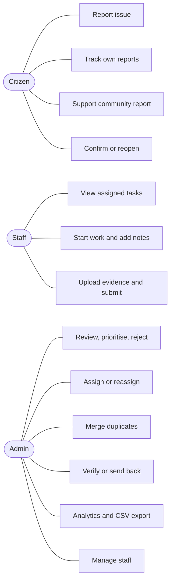
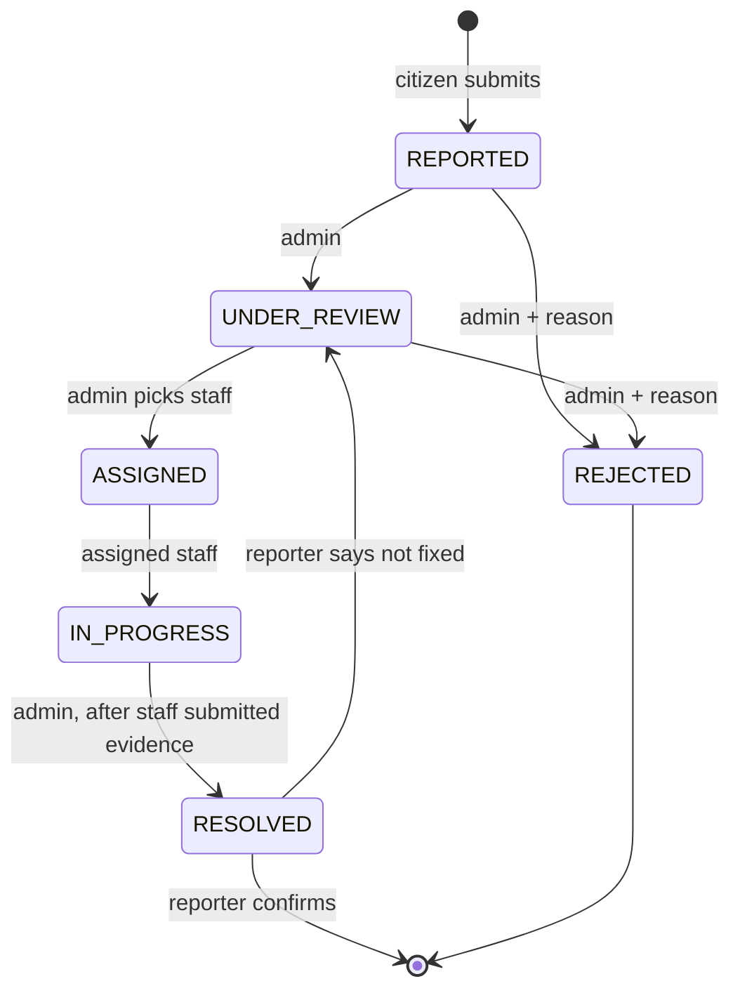
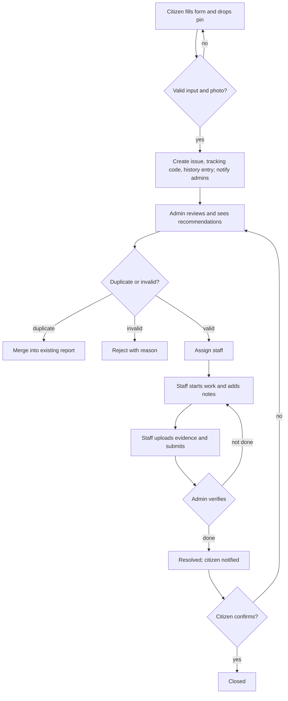
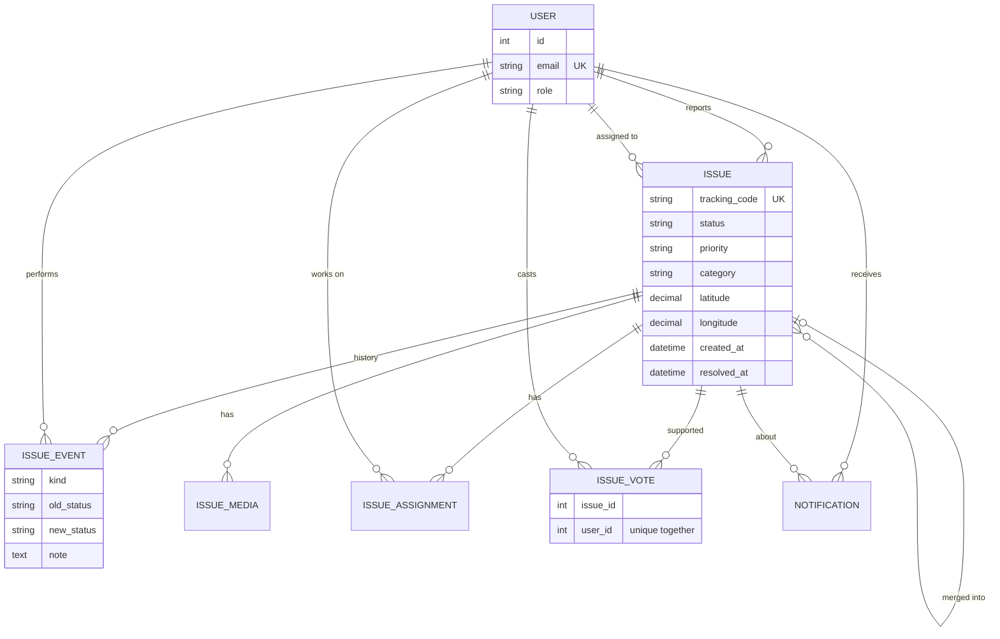
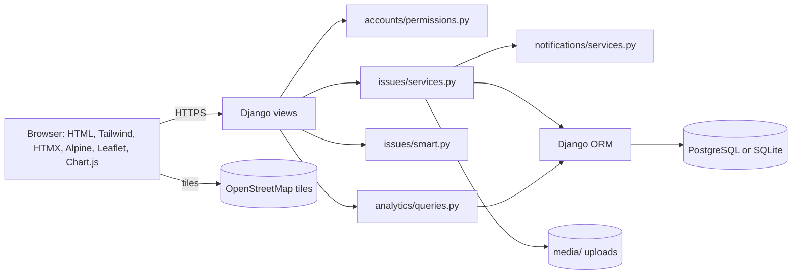

# CivicPulse: Diagrams

All diagrams are Mermaid. They render on GitHub, in VS Code (Markdown Preview Mermaid) and at mermaid.live.

## Use cases



## Status workflow (state diagram)



## Activity: from report to resolution



## Sequence: a status change

```mermaid
sequenceDiagram
  actor Admin
  participant View as IssueActionView
  participant Perm as permissions.py
  participant Svc as services.change_status
  participant DB as Database
  Admin->>View: POST /issues/CODE/action/ (action=review)
  View->>Perm: can_view_issue(user, issue)
  Perm-->>View: allowed
  View->>Svc: change_status(issue, UNDER_REVIEW, admin)
  Svc->>DB: BEGIN; SELECT ... FOR UPDATE
  Svc->>Svc: check transition table and role rule
  Svc->>DB: UPDATE issue; INSERT IssueEvent; INSERT Notification(s)
  Svc->>DB: COMMIT
  View-->>Admin: redirect to detail with a toast
```

## Entity relationships



## Architecture


